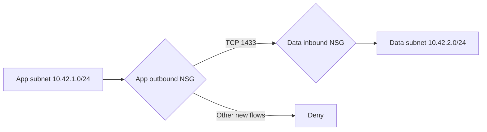

# ATLAS Azure Network Segmentation Lab

An Azure lab that deploys two private subnets and applies a narrow application-to-data rule. The completed exercise combines **real Azure configuration evidence** with a separately identified **offline model of new-flow decisions**. All three Azure resources were deleted after evidence capture.

**Completed 15 October 2026 · North Europe · No VMs or packet tests · Expected infrastructure cost USD 0**

## Demonstrated result

- Deployed `vnet-atlas-segmentation` with app `10.42.1.0/24` and data `10.42.2.0/24` subnets.
- Verified `defaultOutboundAccess: false` and a distinct NSG binding on each subnet in the portal's actual resource JSON.
- Created six custom NSG rules. Only app-to-data TCP/1433 has an explicit allow; catch-all inbound and outbound denies precede Azure's default allows.
- Ran **32 configuration checks, 10 modeled flow cases and 4 mutation checks**, all passing against the sanitized captures.
- Verified Azure's successful deletion notification and an empty resource list on 15 October.

No database, VM, NIC, public endpoint or packet generator was deployed. An allowed result means the offline model selected allow rules; it does **not** demonstrate a working SQL connection. Private subnets and NSGs do not create application encryption or authentication.



## Review the evidence

| Artifact | What it establishes |
|---|---|
| [VNet resource JSON](evidence/vnet-resource.json) | Captured address space, two subnet definitions, private settings and NSG bindings |
| [App NSG JSON](evidence/app-nsg-resource.json) / [Data NSG JSON](evidence/data-nsg-resource.json) | Captured rules, priorities, provisioning states and reciprocal subnet references |
| [Offline verification report](evidence/offline-verification.json) | Actual local execution results, rule traces, mutations and input hashes |
| [Evidence provenance](evidence/README.md) | Capture method, redactions and limits |
| [Results](docs/RESULTS.md) / [Cleanup](docs/CLEANUP.md) | Observed Azure outcomes, modeled outcomes and deletion record |

The JSON files are sanitized **resource-state captures**, not ARM deployment templates. Subscription identifiers are replaced with `<subscription-id>`; etags and resource GUIDs are removed. Lab names, rule values and original path casing are retained. Raw portal captures remain private.

## Run the offline checks

Python 3.10+; standard library only. From this repository:

```sh
python scripts/verify.py
```

To generate a fresh report without replacing the original evidence:

```sh
python scripts/verify.py --report verification-local.json
```

Expected summary: `PASS: 32/32 configuration checks, 10/10 modeled flows, 4/4 mutations detected`.

The script makes no network calls, needs no Azure credentials and creates no cloud resources. Review the [flow fixtures](tests/flows.json) and [implementation](scripts/verify.py). The model evaluates the captured custom IPv4 TCP/UDP rules for new flows only; it does not emulate Azure state tracking, routing, platform exceptions, service tags or NIC policy.

## Reproduce and understand

- [Design and six-rule matrix](docs/DESIGN.md)
- [Portal reproduction runbook](docs/RUNBOOK.md)
- [Cost boundary and credit observations](docs/COSTS.md)
- [Verified results and limitations](docs/RESULTS.md)

This is a deliberately restrictive learning configuration, not a production baseline. Production dependencies, management paths, DNS, TLS, identity and operational monitoring require separate design and testing.

## Portfolio context

This lab extends [ATLAS Policy Guardrails](https://github.com/babbasassy/atlas-azure-policy-guardrails-lab), [SOC Detection Engineering](https://github.com/babbasassy/atlas-soc-detection-engineering-lab) and [Observability and Governance](https://github.com/babbasassy/atlas-azure-observability-governance-lab).

Work occurred across 14–15 October 2026 with interruptions. Active work time was not measured. The final portal reading was USD 200 remaining trial credit and current cost 0.00; this is provisional billing information, not a final invoice.
