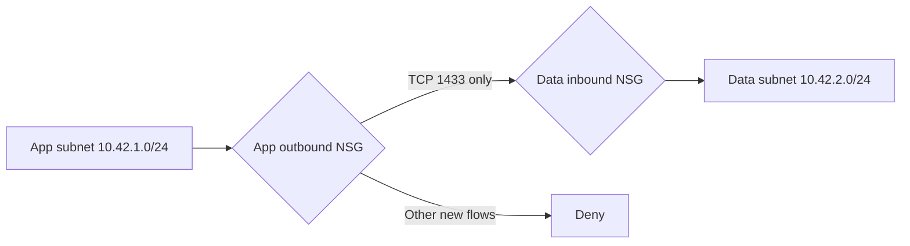

# Two-tier segmentation design

This lab separates configuration evidence in Azure from a local model of new-flow rule decisions. No VM, database, NIC, public endpoint or packet generator is part of the design.

The VNet address space is `10.42.0.0/16`. Both subnet definitions explicitly disable default outbound access and attach distinct NSGs. No NAT, peering, gateway, load balancer, paid DDoS plan, Bastion or flow logging is included.

| NSG | Direction | Priority | Rule | Source | Destination | Protocol / destination port |
|---|---|---:|---|---|---|---|
| nsg-atlas-app | Outbound | 100 | Allow-App-To-Data-SQL | 10.42.1.0/24 | 10.42.2.0/24 | TCP / 1433 |
| nsg-atlas-app | Inbound | 1000 | Deny-All-Inbound | Any | Any | Any / Any |
| nsg-atlas-app | Outbound | 1000 | Deny-All-Outbound | Any | Any | Any / Any |
| nsg-atlas-data | Inbound | 100 | Allow-App-To-Data-SQL | 10.42.1.0/24 | 10.42.2.0/24 | TCP / 1433 |
| nsg-atlas-data | Inbound | 1000 | Deny-All-Inbound | Any | Any | Any / Any |
| nsg-atlas-data | Outbound | 1000 | Deny-All-Outbound | Any | Any | Any / Any |

All source ports are `*`. Lower numeric priorities win. The explicit deny rules precede Azure's default VirtualNetwork and Internet allows; separate subnet names alone do not establish isolation. Azure NSGs are stateful, so replies to an established permitted flow do not require a reverse allow rule. New connections in the reverse direction are a different case.

This deliberately restrictive exercise is not a production-ready application network. Operating-system updates, management, DNS dependencies and application-specific flows need separate design. Azure platform traffic has exceptions to ordinary NSG processing; the local model does not claim to reproduce these, service tags, state tracking, routes, network-manager security admin rules, IPv6 or NIC-level policy.

Sources checked 14 October 2026:
- [NSG rule processing, defaults and platform exceptions](https://learn.microsoft.com/en-us/azure/virtual-network/network-security-groups-overview)
- [Private subnets and default outbound access](https://learn.microsoft.com/en-us/azure/virtual-network/ip-services/default-outbound-access)
